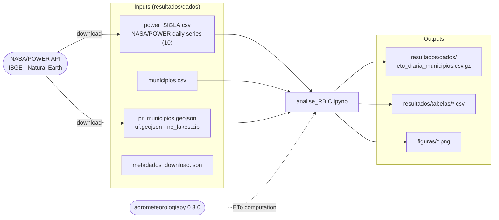

# ETo in western Paraná with NASA/POWER data


[](https://colab.research.google.com/github/fcoliveira-utfpr/ETo_oeste_pr/blob/main/analise_RBIC.ipynb)


Data, code, and results for the article **"Performance of alternative reference evapotranspiration methods with NASA/POWER data in western Paraná, Brazil"** , by Fabrício Correia de Oliveira et al. from Federal University of Technology – Paraná, UTFPR, Santa Helena Campus.

> This repository accompanies the article submitted to the **Revista Brasileira de Iniciação Científica (RBIC)**,
> published by IFSP, in 2026. The manuscript is not included here while it is under review.

## Study summary

Daily reference evapotranspiration (ETo) was estimated using the standard FAO-56 Penman-Monteith method (PM-FAO56) and
six alternative methods (Hargreaves-Samani, regionally calibrated Hargreaves-Samani – GHS, Camargo, Turc,
Priestley-Taylor, and Makkink) for ten municipalities with Cfa climate in western Paraná, Brazil, using NASA/POWER
daily series from 1995 to 2025. The methods were compared against PM-FAO56 using RMSE, MAE, bias, NSE, r, d, and the
Camargo and Sentelhas performance index c.

| Method | RMSE (mm d⁻¹) | Bias (mm d⁻¹) | NSE | c | Performance |
|---|---|---|---|---|---|
| Turc | 0.49 | 0.00 | 0.912 | 0.936 | Excellent |
| Priestley-Taylor | 0.65 | 0.27 | 0.837 | 0.918 | Excellent |
| Makkink | 0.82 | −0.62 | 0.747 | 0.881 | Excellent |
| Hargreaves-Samani | 0.86 | 0.28 | 0.722 | 0.822 | Very good |
| GHS | 1.23 | 0.87 | 0.409 | 0.750 | Good |
| Camargo | 1.19 | −0.54 | 0.477 | 0.629 | Fair |

Means of the eight independent meteorological series (Foz do Iguaçu, Medianeira, and São Miguel do Iguaçu fall within
the same NASA/POWER grid cell). Full values in `resultados/tabelas/desempenho_regional.csv`.

## How to run

**On Google Colab:** click the *Open in Colab* badge above and use *Runtime > Run all*. The notebook installs the
dependencies and downloads all data (NASA/POWER, IBGE boundaries, and Natural Earth).

**Locally:**

```bash
git clone https://github.com/fcoliveira-utfpr/ETo_oeste_pr.git
cd ETo_oeste_pr
pip install -r requirements.txt
jupyter notebook analise_RBIC.ipynb
```

Previously downloaded data are stored in `resultados/dados/`; to download them again, set `FORCAR_DOWNLOAD = True` in
the first code cell.

## File organization



```
ETo_oeste_pr/
├── analise_RBIC.ipynb             full analysis notebook
├── requirements.txt
├── resultados/
│   ├── dados/
│   │   ├── municipios.csv          municipalities, IBGE code, coordinates, and elevation
│   │   ├── power_CAS.csv ... power_TOL.csv   NASA/POWER daily series (1995-2025)
│   │   ├── metadados_download.json  API version, sources, and access date
│   │   ├── eto_diaria_municipios.csv.gz      daily variables and ETo by method
│   │   └── pr_municipios.geojson, uf.geojson, ne_lakes.zip   map base layers
│   └── tabelas/
│       ├── desempenho_regional.csv, desempenho_regional_amplitude.csv
│       ├── desempenho_por_municipio.csv
│       ├── classes_indice_c.csv
│       ├── caracterizacao_meteorologica.csv, eto_media_mensal_regional.csv
│       ├── correlacao_pearson.csv, correlacao_pearson_anomalias.csv
│       ├── vento_desempenho_series_independentes.csv, vento_desempenho_testes.csv
│       ├── sensibilidade_vento_WS2M.csv
│       └── resumo_numeros.json
└── figuras/                        article figures (PNG, 300 dpi)
```

## Data dictionary

**`power_SIGLA.csv`** (NASA/POWER, Agroclimatology community, one row per day)

| Column | Description | Unit |
|---|---|---|
| `T2M_MAX`, `T2M_MIN` | maximum and minimum air temperature at 2 m | °C |
| `RH2M` | relative humidity at 2 m | % |
| `PRECTOTCORR` | corrected precipitation | mm d⁻¹ |
| `ALLSKY_SFC_SW_DWN` | global solar radiation | MJ m⁻² d⁻¹ |
| `TOA_SW_DWN` | top-of-atmosphere radiation | MJ m⁻² d⁻¹ |
| `WS2M`, `WS10M`, `WS50M` | native wind speed at 2, 10, and 50 m | m s⁻¹ |
| `WSC` | wind speed corrected to 10 m over grass (`airportgrass`) | m s⁻¹ |

**`eto_diaria_municipios.csv.gz`** (one row per municipality and day)

| Column | Description |
|---|---|
| `Tmax`, `Tmin`, `Tmed`, `UR`, `P`, `Rs` | input meteorological variables |
| `u2` | wind speed at 2 m derived from `WSC` using FAO-56 (Eq. 47) |
| `Ra`, `Ra_POWER` | top-of-atmosphere radiation: astronomical (used) and NASA/POWER |
| `Rso`, `BOC`, `BOL`, `Rn` | clear-sky radiation, net shortwave and longwave balances, and net radiation |
| `es`, `ea`, `Delta`, `gamma` | vapor pressures, slope of the saturation vapor pressure curve, and psychrometric constant |
| `PM`, `PM_rad`, `PM_aero` | PM-FAO56 ETo and its radiative and aerodynamic terms (mm d⁻¹) |
| `HS`, `GHS`, `Cam`, `Tur`, `PT`, `Mak` | ETo from the alternative methods (mm d⁻¹) |

> Note: the Foz do Iguaçu coordinate used in the analysis (−25.4708; −54.4824) lies in the neighboring municipality of
> Santa Terezinha de Itaipu, within the same NASA/POWER grid cell (details in `municipios.csv`).

## Main procedures

- Wind at 2 m: NASA/POWER wind speed corrected to 10 m over grass, converted with the FAO-56 logarithmic profile;
  native `WS2M` produced implausible values (0.09 m s⁻¹ in Cascavel) and was evaluated only as a sensitivity analysis.
- PM-FAO56 with albedo of 0.23, Δ computed at Tmed, Rs/Rso ≤ 1, and astronomical Ra at each municipality's location.
- Makkink with the −0.12 mm d⁻¹ term; Camargo with F = 0.01 (mean annual temperature ≤ 23.5 °C).
- Metrics in mm d⁻¹; regional performance computed as the mean of the independent meteorological series.

## Data and software references

- NASA Langley Research Center. POWER Project – Daily API v2.10.0. https://power.larc.nasa.gov/
- Oliveira, F. C. agrometeorologiapy: agrometeorology formulas in Python, v. 0.3.0.
  https://pypi.org/project/agrometeorologiapy/
- IBGE. Territorial boundaries (Malhas API). https://servicodados.ibge.gov.br/
- Natural Earth. Lakes and reservoirs, 1:10m. https://www.naturalearthdata.com/

## Contact

Fabrício Correia de Oliveira – fcoliveira@utfpr.edu.br – UTFPR, Santa Helena Campus
